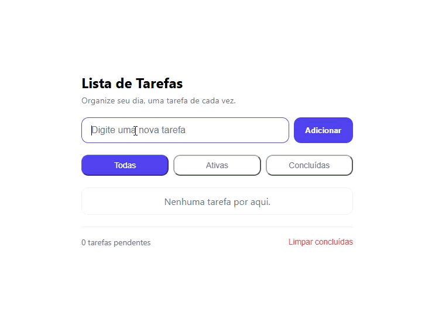

# lista de tarefas

Aplicações de lista de tarefas com filtros, persistência local e tema claro/escuro. Feita com HTML, CSS e JavaScript puro — sem frameworks, sem dependências.

## Demo ao vivo

[Acesse o app](https://github.com/rikrdopires/Projeto-2---To-Do.git)

## Funcionalidades

- Adicionar, concluir e remover tarefas
- Filtrar por todas / ativas / concluídas
- Limpar todas as concluídas de uma vez
- Contador de tarefas pendentes
- Persistência com `localStorage`
- Tema claro/escuro
- Edição de tarefa com duplo clique
- Acessibilidade básica (aria-labels, foco visível)

## Tecnologias

- HTML5 semântico
- CSS3 (variáveis, Flexbox, animações)
- JavaScript ES6+ (DOM, eventos, `localStorage`, JSON)

## O que aprendi

- Separar **estado** de **renderização** (padrão `estado → render → eventos`)
- Manipulação dinâmica do DOM com `createElement` e `appendChild`
- Persistência com `localStorage` e serialização com `JSON`
- Organização de código em ações, auxiliares, renderização e eventos
- Acessibilidade básica com `aria-label` e utilitário `.sr-only`
- Debugging com DevTools (Console, Elements, Network, Application)

## Preview

 

## Como rodar

Basta abrir o `index.html` no navegador. Não há build, não há dependências.

## 📂 Estrutura

## Autor
Feito por **Ricardo Ribeiro** como parte do meu portfólio de estudos em ADS.